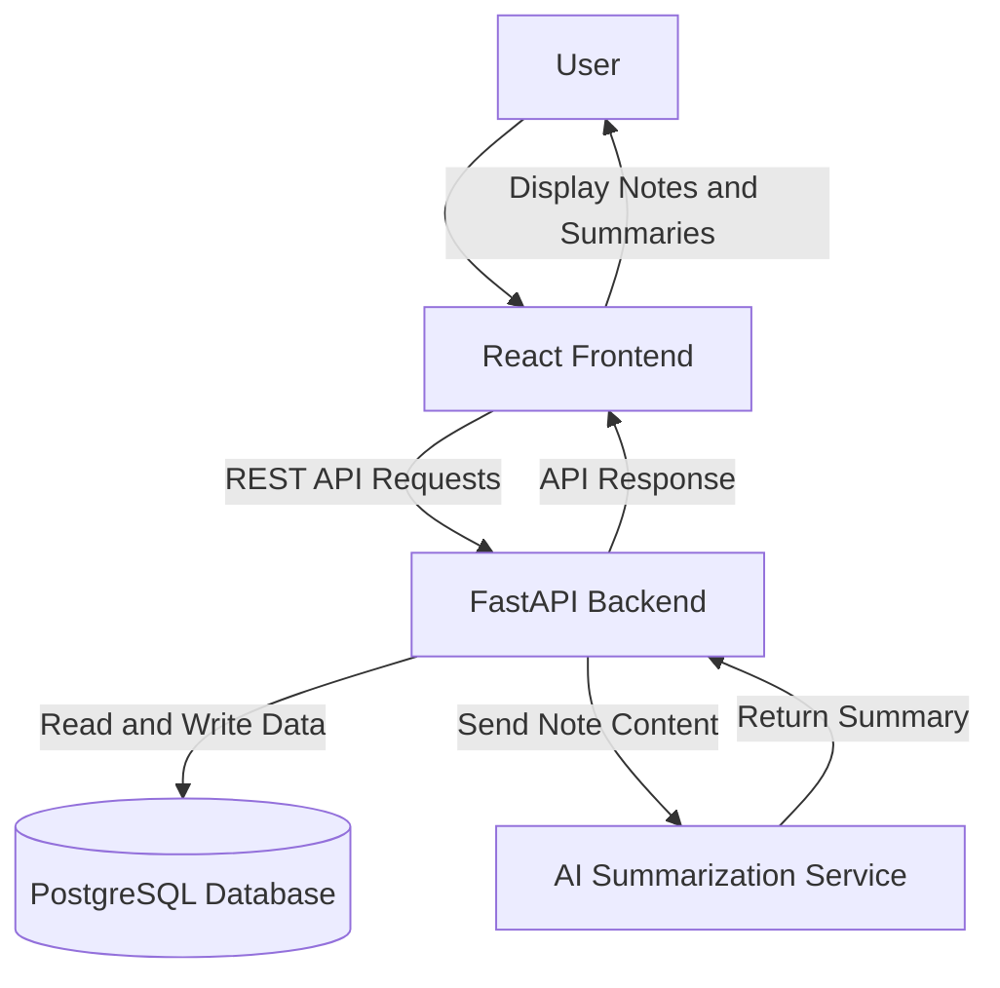

# System Architecture – AI-Powered Personal Knowledge Organizer

## 1. Architecture Overview

The application follows a client-server architecture. The frontend provides the user interface, while the backend handles business logic, data operations, and communication with the AI service. PostgreSQL stores notes, tags, and user-related data.

## 2. Main Components

### Frontend
- Provides the user interface and notes dashboard.
- Allows users to create, edit, delete, search, and filter notes.
- Displays AI-generated summaries.
- Communicates with the backend through REST API requests.

**Suggested technology:** React

### Backend
- Handles incoming API requests.
- Validates user input.
- Implements note, tag, and favorite management.
- Retrieves and updates data in the database.
- Sends note content to the AI service when a summary is requested.

**Suggested technology:** Python with FastAPI

### Database
- Stores notes, tags, and user information.
- Maintains relationships between notes and tags.
- Stores favorite status and timestamps.

**Suggested technology:** PostgreSQL

### AI Service
- Receives note content from the backend.
- Generates concise summaries.
- Returns the generated summary to the backend.

**Suggested technology:** External AI API

## 3. High-Level System Diagram

## 4. Main Data Flow

1. The user interacts with the React frontend.
2. The frontend sends an HTTP request to the FastAPI backend.
3. The backend validates the request and performs the required operation.
4. For normal note operations, the backend communicates with PostgreSQL.
5. For summarization, the backend sends the selected note content to the AI service.
6. The AI service returns the generated summary.
7. The backend sends the response to the frontend.
8. The frontend displays the result to the user.

## 5. Architectural Constraints

- The frontend and backend communicate through REST APIs.
- The database is accessed through the backend only.
- AI API credentials are stored securely on the backend.
- AI summarization depends on the availability of the external AI service.
- The initial version focuses on a simple, maintainable architecture rather than microservices.