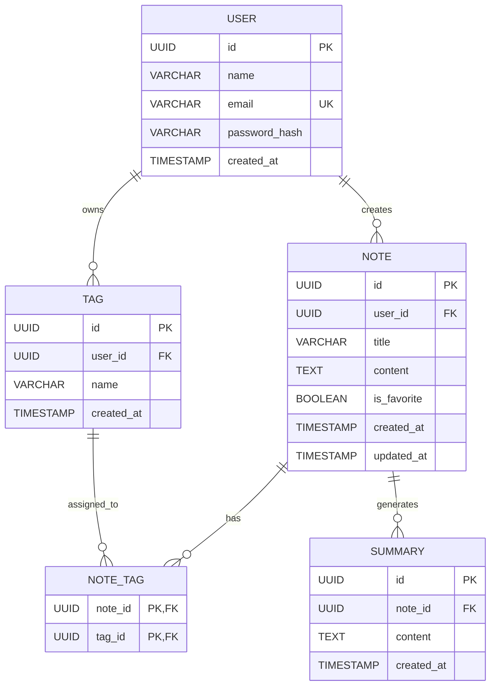

# Data Model – AI-Powered Personal Knowledge Organizer

## 1. Overview

The application uses a relational database to store users, notes, tags, favorites, and AI-generated summaries.

The data model consists of five main entities:

1. User
2. Note
3. Tag
4. NoteTag
5. Summary

## 2. Entities and Attributes

### Entity 1 – User

Stores information about registered users.

| Attribute | Data Type | Description |
|---|---|---|
| id | UUID | Primary key |
| name | VARCHAR(100) | User's name |
| email | VARCHAR(255) | User's unique email address |
| password_hash | VARCHAR(255) | Hashed password |
| created_at | TIMESTAMP | Account creation date |

### Entity 2 – Note

Stores notes created by users.

| Attribute | Data Type | Description |
|---|---|---|
| id | UUID | Primary key |
| user_id | UUID | Foreign key referencing User |
| title | VARCHAR(255) | Note title |
| content | TEXT | Note content |
| is_favorite | BOOLEAN | Whether the note is a favorite |
| created_at | TIMESTAMP | Note creation date |
| updated_at | TIMESTAMP | Last modification date |

### Entity 3 – Tag

Stores tags used to organize notes.

| Attribute | Data Type | Description |
|---|---|---|
| id | UUID | Primary key |
| user_id | UUID | Foreign key referencing User |
| name | VARCHAR(100) | Tag name |
| created_at | TIMESTAMP | Tag creation date |

### Entity 4 – NoteTag

A junction entity that implements the many-to-many relationship between notes and tags.

| Attribute | Data Type | Description |
|---|---|---|
| note_id | UUID | Foreign key referencing Note |
| tag_id | UUID | Foreign key referencing Tag |

**Primary Key:** Composite key consisting of `note_id` and `tag_id`.

### Entity 5 – Summary

Stores AI-generated summaries of notes.

| Attribute | Data Type | Description |
|---|---|---|
| id | UUID | Primary key |
| note_id | UUID | Foreign key referencing Note |
| content | TEXT | Generated summary |
| created_at | TIMESTAMP | Summary generation date |

## 3. Entity Relationships

- **User → Note:** One user can create multiple notes. Each note belongs to one user (one-to-many).
- **User → Tag:** One user can create multiple tags. Each tag belongs to one user (one-to-many).
- **Note ↔ Tag:** A note can have multiple tags, and a tag can be assigned to multiple notes (many-to-many), implemented through NoteTag.
- **Note → Summary:** One note can have multiple generated summaries. Each summary belongs to one note (one-to-many).

## 4. Relationship Diagram

## 5. Data Integrity Rules

- Each user must have a unique email address.
- Every note must belong to an existing user.
- Every tag must belong to an existing user.
- A note can only be associated with tags belonging to the same user.
- Duplicate note-tag associations are not allowed.
- Deleting a note should also delete its associated NoteTag and Summary records.
- Deleting a user should delete their notes and tags.